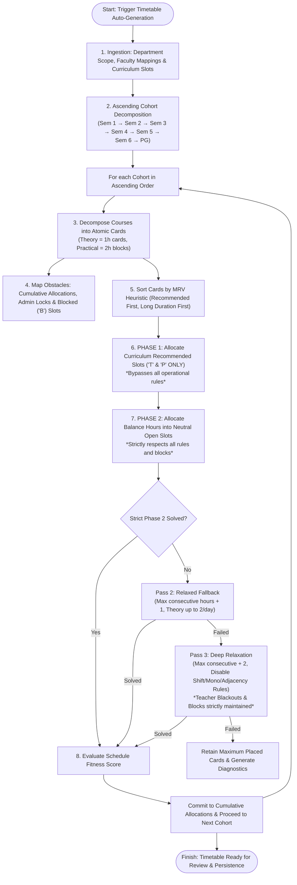

# Timetable Auto-Generation Engine: Complete Architecture & Rules Specification

This document provides the definitive, systematic explanation of how the automated timetable generation engine operates in the **College Timetable Allocation System** (`server/scheduler.js`), detailing its flow, phases, invariant rules, and troubleshooting principles.

---

## 1. Executive Summary & Design Principles

The auto-generation engine is a **Constraint Satisfaction Problem (CSP)** backtracking solver. Its primary goal is to produce a feasible, conflict-free timetable while strictly adhering to curriculum requirements.

### Core Architectural Axioms
1. **Unconditional Recommended Slot Bypass**: Slots designated as curriculum-recommended (`T` or `P`) represent deliberate academic decisions by curriculum planners. When placing cards into their matching recommended slots, the engine **bypasses all operational constraints** (such as external clashes, teacher fatigue, or cohort overlap) to ensure institutional curriculum structure is 100% honored.
2. **Only `T` and `P` are Recommended Slots**:
   - **`T`** = Theory Recommended Slot.
   - **`P`** = Practical / Lab Recommended Slot.
   - **`M` is NOT a recommended slot**: The letter `M` represents a course category / Major-Minor classification and is **never** treated as a recommended slot value.
3. **Ascending Cohort Processing Order**: Multi-cohort and multi-semester generation solves in **ascending order** ($\text{Sem 1} \rightarrow \text{Sem 2} \rightarrow \text{Sem 3} \rightarrow \dots \rightarrow \text{Sem 6} \rightarrow \text{PG}$). Junior/earlier semesters contain the highest concentration of strict curriculum-recommended slots and foundational requirements, so they must be assigned and locked first.
4. **Absolute Prohibition of Blocked Periods (`B`)**: Slots marked as **`B`** (Blocked) in the Curriculum Slot Allocation must **never** receive any class allocation under any circumstances across all phases, passes, and relaxation modes.

---

## 2. High-Level Flowchart



---

## 3. Systematic Phase & Rule Breakdown

### Phase 1: Recommended Slots Allocation (`T` and `P` ONLY)

The curriculum planning tool allows departments to designate fixed, optimal slots for courses:
- **`T` (Theory Slot)**: Theory courses (`type: 'T'`) strictly match periods tagged with `T`.
- **`P` (Practical Slot)**: Practical lab courses (`type: 'P'`) strictly match 2-hour period blocks tagged with `P` (e.g., Periods 1–2, 4–5, 5–6).
- **`M` IS NOT A RECOMMENDED SLOT**:
  - The value `M` is used in course definitions for **Major/Minor** or allied course categorizations.
  - The engine strictly filters: only `val === 'T'` and `val === 'P'` trigger recommended slot logic. Any slot containing `M`, blank, or other characters is treated as neutral or non-recommended.

#### The Unconditional Rule Bypass in Phase 1
When a card is being placed into its matching recommended slot (`isRecommendedSlot(card, day, periodsGroup) === true`):
- **Why it bypasses**: Curriculum designers intentionally chose these specific slots as institutional mandates. If teacher availability, fatigue rules, or soft preferences were allowed to veto them, curriculum adherence would drop.
- **Rule behavior in Phase 1**:
  - Teacher fatigue checks: **Bypassed**.
  - Teacher unwanted/blackout periods: **Strictly Honored (NEVER bypassed or allocated)**.
  - Shift balancing & anti-mono-period heuristics: **Bypassed**.
  - Single-hour theory spread heuristics: **Bypassed**.
  - **BLOCKED (`B`) CHECK IS NEVER BYPASSED**: If a slot is marked `B`, it is a block and can never be a recommended slot.

---

### Phase 2: Balance & Overflow Hours Allocation (Neutral Slots)

Once all curriculum-recommended slots are scheduled, courses that require additional weekly hours (e.g., a 4-hour theory course that only has 2 recommended slots) enter **Phase 2**.

In Phase 2, cards are allocated into **Neutral Open Slots** subject to strict operational and pedagogical rules:
1. **Strict Practical / Theory Isolation**:
   - Theory cards are **strictly prohibited** from taking slots marked with `P` in the curriculum.
   - Practical cards are **strictly prohibited** from taking slots marked with `T` in the curriculum.
2. **Absolute Block Enforcement (`B`)**:
   - Any slot tagged as `B` is strictly disqualified.
3. **Candidate Slot Ranking Heuristics**:
   - **Priority 1: Weekday Spread**: Strongly prefers days where this course currently has **0 hours**, then **1 hour**, then **2 hours** (ensuring a 4-hour course is spread across 4 separate days).
   - **Priority 2: Student Daily Balance**: Prefers days with fewer overall lectures scheduled for this semester cohort.
   - **Priority 3: Anti-Mono-Period**: Prevents assigning the same subject to the exact same period index every day (avoids teaching Period 1 all 5 days).
   - **Priority 4: Shift Balancing**: Distributes sessions evenly between Morning (Periods 1–3) and Afternoon (Periods 4–6).
   - **Priority 5: Anti-Adjacency**: Avoids back-to-back adjacent periods of the same theory course on the same day.

---

## 4. Cohort Processing Order: Ascending Prioritization

When auto-generation runs across multiple semesters or program types, the decomposition order determines which cohort gets first claim on shared resources.

### Why Ascending Order ($\text{Sem 1} \rightarrow \text{Sem 2} \rightarrow \text{Sem 3} \rightarrow \dots \rightarrow \text{Sem 6} \rightarrow \text{PG}$)?
1. **High Concentration of Recommended Slots in Early Semesters**:
   - First-year and foundational semesters (`Sem 1` and `Sem 2`) have heavily structured curricula with common foundation courses, allied theory papers, and compulsory lab blocks (`T` and `P`).
   - Senior semesters (`Sem 5` and `Sem 6`) have more electives, project hours, and flexible allocations.
2. **Foundational Schedule Stability**:
   - By scheduling junior semesters first, their extensive compulsory recommended slots are locked in place without being obstructed by senior elective placements.
3. **Cumulative Obstacle Carryover**:
   - After `Sem 1` finishes, its assigned slots are added to `cumulativeAllocations`.
   - `Sem 3` then schedules around `Sem 1`'s allocations, preventing cross-semester teacher collisions.
   - Senior semesters and PG classes fill the remaining flexible slots.

---

## 5. Blocked Periods (`B`): Invariant Rules & Troubleshooting

### What is a Blocked Period (`B`)?
In the **Curriculum Slot Allocation** interface, coordinators can mark slots with **`B`** with two distinct granular scopes:
1. **Course-Specific Block (`B`)**:
   - Selected when a **specific course** is selected in the "Block Target" dropdown (e.g. `MAT4CJ205`).
   - Prohibits **only that specific course** from being scheduled in that slot on that day.
   - **Crucial**: Other courses in the same semester do **not** inherit this block and can still be scheduled into that slot freely.
2. **Entire Semester Block**:
   - Selected when **"Entire Semester (All Courses)"** (`ALL`) is selected in the "Block Target" dropdown.
   - Prohibits **all courses** in that semester from being scheduled in that slot on that day.
   - Completely blacks out that period across the entire cohort.
- **Rule Level**: **Absolute Hard Invariant (Level 1)**: Neither course-specific blocks nor semester blocks can ever be assigned under any circumstances or relaxation modes.

### Why Auto-Generation Was Assigning Periods into Blocked Slots

If you notice auto-generation placing subjects into slots marked `B`, the root causes are:

```
┌────────────────────────────────────────────────────────────────────────────────────────┐
│                        HOW BLOCKED PERIODS GET BYPASSED (ROOT CAUSES)                  │
├────────────────────────────────────────────────────────────────────────────────────────┤
│ 1. Course-Specific vs Semester Scope:                                                  │
│    When 'B' is saved in `courseRecommendations[courseCode]`, it only marks that single │
│    course. If other courses in the same semester do NOT have 'B' marked on their row,  │
│    the solver treats that period as completely open for those other courses!           │
│                                                                                        │
│ 2. Data Type Mismatch (String vs Number Period Keys):                                  │
│    In JavaScript, checking `card.recommendations[day][p]` when `p` is an integer (e.g. │
│    1) while the recommendation object stores keys as strings (`"1"`) causes the lookup │
│    to return `undefined`, silently bypassing the block check!                          │
│                                                                                        │
│ 3. Missing Metadata on Cloned Cards:                                                   │
│    When practical blocks or theory cards are created, if `card.recommendations` is     │
│    not deep-copied or missing its parent metadata, `canPlaceCard()` falls back to      │
│    checking an empty object, allowing the card to be placed in the blocked period.     │
│                                                                                        │
│ 4. Semester Block Matching Mismatch:                                                   │
│    When blocked periods are saved as `globalLockedPeriods` with `semester: "Sem 1"`,   │
│    but the course has `semester: "1"`, string mismatch prevents the lock from firing!  │
└────────────────────────────────────────────────────────────────────────────────────────┘
```

### The Correct Block Rule Implementation
To guarantee that `B` is **never** violated:
1. **Course-Level Check**: If `card.recommendations[day][String(p)] === 'B'`, the slot is immediately disqualified.
2. **Cohort/Semester-Level Check**: If *any* course in that semester or the semester block settings marks a slot as `B`, all courses belonging to that cohort must honor the block.
3. **No Relaxation**: Unlike teacher fatigue or blackouts, **`B` blocks are NEVER relaxed**, even in Pass 3 (Deep Relaxation).

---

## 6. Complete Constraint Hierarchy & Relaxation Policy

When the schedule encounters heavy clashes or deadlocks, the engine uses a strict policy distinguishing between **Soft Constraints (which can be turned OFF or relaxed)** and **Hard Invariants (which can NEVER be turned off or allocated into)**:

```
+---------------------------------------------------------------------------------------------------------+
|                                        CONSTRAINT HIERARCHY                                             |
+---------------------------------------------------------------------------------------------------------+
|  LEVEL 1: ABSOLUTE HARD INVARIANTS (NEVER RELAXED & NEVER RECEIVE ANY ALLOCATION)                       |
|  - Blocked Periods ('B') in Curriculum Slot Allocation (Zero allocations permitted)                     |
|  - Teacher Unavailability marked in Teacher Availability (Faculty blackouts strictly honored 100%)       |
|  - Admin Global Locked Periods (College assemblies, common locked hours)                                |
|  - Lunch Break ('LB') Exclusion (Zero teaching permitted)                                               |
|  - Continuous Unbroken Practicals (Labs cannot cross intervals or lunch breaks)                         |
|  - Zero Faculty Double-Booking (Internal department & external department clash protection)             |
|  - Zero Student Cohort Clashes (Students in the same semester cannot have parallel classes)             |
|  - Single Laboratory Occupancy Limit (Only one practical class in the lab at any given period)          |
+---------------------------------------------------------------------------------------------------------+
|  LEVEL 2: CURRICULUM PRIORITY INVARIANTS (Phase 1 Protection)                                           |
|  - Pre-designated Recommended Slots ('T' and 'P' ONLY) bypass operational soft heuristics              |
|  - Theory cards STRICTLY prohibited from taking Practical ('P') slots                                   |
|  - Practical cards STRICTLY prohibited from taking Theory ('T') slots                                  |
+---------------------------------------------------------------------------------------------------------+
|  LEVEL 3: SOFT CONSTRAINTS (CAN BE TURNED OFF OR RELAXED WHEN OVERCONSTRAINED / HEAVY CLASHES)         |
|  - Teacher consecutive teaching limit (Relaxed: 2h -> 3h -> 4h max continuous hours)                   |
|  - Daily theory course lecture cap (Relaxed: 1 hr/day -> 2 hrs/day stacking)                            |
|  - Weekday spread preference (Relaxed to allow course hours concentrated on fewer days)                 |
|  - Morning / Afternoon shift balance (Turned OFF under deadlock)                                        |
|  - Anti-mono-period diversity (Turned OFF under deadlock; same period index may repeat)                  |
|  - Anti-adjacency rule (Turned OFF under deadlock; back-to-back same-theory periods allowed)             |
|  - Equal hour distribution across co-teachers (Temporarily shifted to place required hours)             |
+---------------------------------------------------------------------------------------------------------+
```

### Key Policy Invariant: What NEVER Gets Allocated
Even when an allocation has extreme clashes:
1. **Curriculum Blocked Slots (`B`)** must NEVER get any allocation.
2. **Teacher Unavailability marked in Teacher Availability** must NEVER get any allocation.
3. **Recommended Slots (`T` & `P`)** must NEVER be assigned to incorrect course types.
If a timetable cannot be resolved without violating these three invariants, the engine stops and reports an explicit bottleneck diagnostic rather than corrupting teacher availability or blocked hours.

---

## 7. Practical Troubleshooting & Verification Guide

When an auto-generated schedule appears incorrect or unexpected, use this checklist:

### 1. Are periods appearing in Blocked (`B`) slots?
- Verify that `B` is saved with string keys (`String(p)`).
- Ensure that if a slot is blocked for the whole class, it is either set across all course rows for that semester or saved as a semester-level block.

### 2. Are slots clashing or teachers double-booked?
- Check if both clashing courses have explicit `T` or `P` recommendations in that same slot. Because recommended slots intentionally bypass operational constraints, conflicting recommendations will result in both courses occupying that slot.
- Remove conflicting recommendations in the **Curriculum Slot Allocation** tab so only the intended subject has the recommendation.

### 3. Did the schedule fall back into Deep Relaxation?
- Check the audit report returned after generation:
  - If `status === "relaxed_with_exceptions"`, look at `exceptionsApplied`.
  - Look for `TEACHER_FATIGUE` (teachers given 3 or 4 continuous hours) or `TEACHER_UNAVAILABLE_OVERRIDE` (blackout slots overridden).
  - **Remedy**: Relax teacher availability blackouts or reduce total course hours mapped to congested faculty.

### 4. Why are some hours missing?
- If the solver exhausts Pass 3 without finding a full solution, it returns **partial allocations** rather than crashing.
- Inspect the diagnostic bottleneck modal: it will identify the exact faculty member or cohort that caused the mathematical deadlock.
