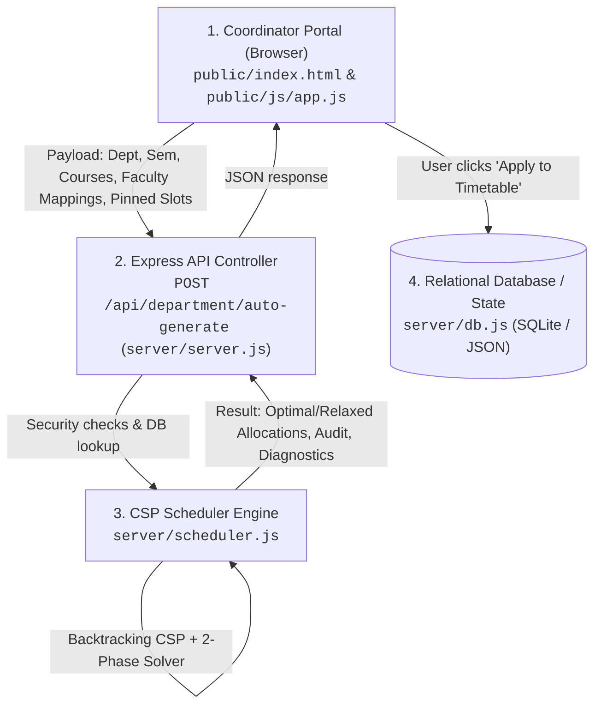

# Automated Timetable Generation Engine: Systematic Process Flow

This document provides a comprehensive, systematic explanation of how the automated timetable generation engine operates in the **College Timetable Allocation System**. 

The engine uses a **Constraint Satisfaction Problem (CSP)** backtracking solver enhanced with **Minimum Remaining Values (MRV)** heuristics, **multi-cohort decomposition**, and a strict **two-phase priority pipeline**.

---

## 1. Architectural Overview & Component Responsibilities

The automated generation system spans the frontend coordinator portal, the backend API controller, and the core constraint-satisfaction engine:



### Key Source Files & Functions
- **Frontend Controller**: [`public/js/app.js`](file:///e:/git_repos/college_time_table/public/js/app.js#L8500-L8800) – `runAutoGeneration()`, `applyAutoGeneratedSchedule()`.
- **API Endpoint**: [`server/server.js`](file:///e:/git_repos/college_time_table/server/server.js#L2834-L2867) – `POST /api/department/auto-generate`.
- **Scheduler Core**: [`server/scheduler.js`](file:///e:/git_repos/college_time_table/server/scheduler.js#L1-L2426):
  - [`generateDepartmentSchedule()`](file:///e:/git_repos/college_time_table/server/scheduler.js#L309) – Main entry point for department schedule generation.
  - [`generateMultiCohortSchedule()`](file:///e:/git_repos/college_time_table/server/scheduler.js#L166) – Multi-semester priority decomposition engine.
  - [`runBacktrackingSolver()`](file:///e:/git_repos/college_time_table/server/scheduler.js#L2005) – Recursive backtracking search engine.
  - [`canPlaceCard()`](file:///e:/git_repos/college_time_table/server/scheduler.js#L1066) – Comprehensive constraint verification engine.
  - [`getPrioritizedCandidatePlacements()`](file:///e:/git_repos/college_time_table/server/scheduler.js#L1696) – Domain variable ordering & heuristic candidate generator.
  - [`evaluateScheduleScore()`](file:///e:/git_repos/college_time_table/server/scheduler.js#L1500) – Schedule fitness evaluation function.

---

## 2. High-Level Systematic Flowchart

The following diagram illustrates the complete step-by-step lifecycle of an auto-generation request:

```mermaid
flowchart TD
    Start(["Start: Coordinator triggers 'Generate Timetable'"]) --> Step1["Step 1: Ingest Scope, Faculty Bindings & Parameter Snapshots"]
    Step1 --> Step2["Step 2: API Authentication & Submission Lock Check"]
    Step2 --> Step3{"Step 3: Multi-Cohort Check<br/>(Multiple Semesters / Programs?)"}
    
    Step3 -- Yes --> MultiCohort["Decompose into Cohorts (Sem 5 > Sem 3 > Sem 1)<br/>Carry forward cumulative allocations"]
    Step3 -- No --> Step4["Step 4: Resolve Faculty Bindings & Workload Balancing"]
    MultiCohort --> Step4

    Step4 --> Step5["Step 5: Decompose Courses into Lesson Cards (Theory = 1h, Practical = 2h)"]
    Step5 --> Step6["Step 6: Map External Constraints (Global Locks, Other Depts, Lab Slots)"]
    Step6 --> Step7["Step 7: Sort Cards by MRV Heuristic (Recommended > Practicals > Single-Teacher)"]
    
    Step7 --> Phase1["Step 8: PHASE 1 — Lock Curriculum-Recommended Slots ('T', 'P', 'M')"]
    Phase1 --> Phase1Check{"Phase 1 Success?"}
    Phase1Check -- No --> Phase1Relax["Phase 1 Relaxed Pass (Preserve Recommended Hours)"]
    Phase1Relax --> Phase2
    Phase1Check -- Yes --> Phase2["Step 9: PHASE 2 — Allocate Balance Hours into Neutral Slots"]

    Phase2 --> StrictSolve{"Strict Phase 2 Solved?"}
    StrictSolve -- Yes --> Score["Step 10: Score Schedule Fitness & Audit Metrics"]
    StrictSolve -- No --> RelaxedPass1{"Attempt Relaxed Pass<br/>(Max consecutive hours + 1)"}
    
    RelaxedPass1 -- Solved --> LogExceptions["Log Soft Exceptions (Teacher Fatigue, Day Stacking)"]
    RelaxedPass1 -- Failed --> DeepRelax{"Attempt Deep Relaxation Pass<br/>(Consecutive + 2, Override Blackouts)"}
    
    DeepRelax -- Solved --> LogExceptions
    DeepRelax -- Failed --> MostPlaced["Fallback: Keep Maximum Cards Placed + Compile Diagnostics"]
    
    LogExceptions --> Score
    MostPlaced --> FailureUI["Step 11: Display In-Section Bottleneck Diagnostics & Suggestions"]
    Score --> SuccessUI["Step 11: Display Audit Metrics, Exceptions & Verification Grid"]
    
    SuccessUI --> UserApply{"User clicks 'Apply to Timetable'?"}
    UserApply -- Yes --> Commit["Commit Allocations to Draft Workspace & Save DB"]
    Commit --> End(["End: Timetable Ready"])
    FailureUI --> UserSmart{"User clicks 'Solve with Smart Exceptions'?"}
    UserSmart -- Yes --> Step1
    UserSmart -- No --> End
```



---

## 3. Detailed Step-by-Step Breakdown

### Step 1: Input Ingestion & Parameter Snapshotting (Client-Side)
- **Scope Selection**: The coordinator selects the program (`All`, `UG`, `PG`), semester (`All`, `Odd`, `Even`, or specific semester `1`–`8`), and specific courses.
- **Selective Subject Filter**: Users can schedule all department courses or selectively check a subset of courses.
- **Parameter Change Detection**:
  - The client inspects previously allocated courses against their current configuration (hours, teacher bindings, course type).
  - Unchanged courses are flagged to be **preserved/pinned** (`pinnedSlots`) so their existing slots are not disturbed.
  - If parameters changed, a modal informs the user and allows them to regenerate only the modified subjects.
- **Teacher Configuration Ingestion**: Ingests teacher mappings, individual teacher hour splits (e.g., 2 hours for Teacher A, 2 hours for Teacher B), and co-teaching assignments.

---

### Step 2: API Validation & Security Gateway
- Endpoint: [`POST /api/department/auto-generate`](file:///e:/git_repos/college_time_table/server/server.js#L2834).
- **Authentication**: Validates coordinator JWT token and extracts department context (`requireDepartment`).
- **Submission Lock Check**: If the department's timetable has already been `SUBMITTED` or `APPROVED` by Central Admin, auto-generation is rejected with HTTP 403 to prevent unauthorized modifications.

---

### Step 3: Multi-Cohort Decomposition (If Applicable)
- When generating for multiple semesters or program types simultaneously (e.g., "All Semesters"):
  - [`generateMultiCohortSchedule()`](file:///e:/git_repos/college_time_table/server/scheduler.js#L166) groups courses by cohort key (`${semester}_${programType}`).
  - **Cohort Prioritization**: Solves from senior classes downward:
    $$\text{Sem 5 (UG)} \longrightarrow \text{Sem 3 (UG)} \longrightarrow \text{Sem 1 (UG)} \longrightarrow \text{PG}$$
  - Each cohort's result is added to `cumulativeAllocations`. Subsequent cohorts schedule around these previously allocated slots, guaranteeing zero cross-semester teacher clashes and conflict-free lab usage.

---

### Step 4: Faculty Assignment Resolution & Workload Balancing
For each course:
1. **Explicit Mappings**: Checks if teachers are specified in request config or saved department mappings (`subjectTeacherMapping`).
2. **Co-Teaching Setup**: For practical courses, multiple assigned faculty are marked as **co-teachers** (assigned simultaneously to the same class and period). For theory courses, multiple teachers split the weekly hours.
3. **Auto-Assignment Fallback**: If no faculty is assigned, the engine automatically selects the department faculty member with the lowest accumulated teaching workload.

---

### Step 5: Decomposing Courses into Lesson Cards
The generator decomposes courses into atomic scheduling units called **Cards**:
- **Practical Courses (`P`)**:
  - Practical hours are strictly normalized to **even numbers** (e.g., 2 hours, 4 hours).
  - Decomposed into **contiguous 2-hour blocks** (`duration: 2`).
  - All assigned practical teachers are placed together (`isDistributed: false`).
- **Theory Courses (`T`) / Multidisciplinary (`M`)**:
  - Decomposed into **1-hour cards** (`duration: 1`).
  - Distributed across individual teachers according to assigned quotas (`isDistributed: true`).
- **Card Tagging**: Each card is tagged as `isRecommended: true` if matching predefined slots in `course.recommendations`, or `isRecommended: false` for balance hours.

---

### Step 6: Environment Mapping & Global Constraints Setup
Before running the solver, the engine constructs static obstacle maps:
1. **External Faculty Commitments**: Scans all other departments' allocations and approved cross-department requests (`db.crossDepartmentRequests`) to block slots where department faculty are already teaching elsewhere.
2. **Laboratory Occupancy**: Maps existing practical sessions across the department/institution to enforce the single-laboratory constraint.
3. **Admin Global Common Locks**: Reads institution-wide locked periods (e.g., College Assembly on Wednesday Period 4), matching semester scopes.
4. **Teacher Blackout Slots**: Reads individual faculty unavailability records configured in the Teacher Availability settings.

---

### Step 7: Variable Ordering via MRV (Most Constrained Variable)
To minimize backtracking depth, the engine sorts cards using the **MRV (Most Constrained Variable)** heuristic:
1. **Recommended Cards First**: Cards with curriculum-recommended slots are scheduled before any balance cards.
2. **Longer Duration First**: 2-hour practical blocks are scheduled before 1-hour theory lectures (hardest to fit contiguous slots).
3. **Fewer Domain Options First**: Courses with fewer available recommended slots are placed ahead of flexible courses.
4. **Fewer Faculty Options**: Courses with fewer eligible teachers are prioritized over courses with large faculty pools.

---

### Step 8: The Two-Phase Priority Pipeline

The scheduling engine operates in two distinct phases:

```
+-------------------------------------------------------------------------------+
| PHASE 1: Curriculum-Recommended Slots (HIGHEST PRIORITY)                     |
| - Strictly schedules cards into pre-designated recommended slots (T, P, M).   |
| - Practical cards strictly take 'P' slots; Theory cards take 'T'/'M' slots.  |
| - Locks in curriculum structure before any open balance slots are considered.  |
+---------------------------------------+---------------------------------------+
                                        |
                                        v
+-------------------------------------------------------------------------------+
| PHASE 2: Balance & Overflow Hours (Neutral Open Slots)                        |
| - Allocates remaining hours into unassigned periods.                         |
| - Theory cards are STRICTLY prohibited from taking recommended Practical slots.|
| - Practical cards are STRICTLY prohibited from taking recommended Theory slots.|
| - Enforces Weekday Spread, Shift Balance, and Anti-Mono-Period rules.          |
+-------------------------------------------------------------------------------+
```

#### Candidate Slot Ordering Heuristics (in Phase 2)
When selecting an open slot for a card, candidate slots are evaluated in order of preference:
1. **Weekday Spread Priority (First Priority)**: Prefers weekdays where this course currently has **0 hours**, then **1 hour**, then **2 hours** (e.g., a 4-hour course is spread across 4 distinct days).
2. **Student Cohort Daily Balance**: Prefers weekdays with fewer total lectures scheduled for this semester.
3. **Anti-Mono-Period (Period Diversity)**: Avoids assigning the course to the exact same period index every day.
4. **Adjacent Slot Penalty**: Avoids back-to-back adjacent periods of the same theory subject on the same day.
5. **Shift Balancing**: Disperses lectures between Morning (Periods 1–3) and Afternoon (Periods 4–6).

---

### Step 9: Constraint Verification Engine (`canPlaceCard`)

For every candidate slot, the solver validates against the full constraint hierarchy:

| Constraint | Category | Rule & Implementation |
| :--- | :--- | :--- |
| **Admin Global Locks** | Hard Invariant | Excludes periods locked college-wide or scoped to this semester. |
| **Lunch Break & Intervals** | Hard Invariant | No lectures in `LB`. Practicals cannot cross interval boundaries (between Periods 2–3 and 3–4). |
| **Zero Faculty Clashes** | Hard Invariant | A teacher cannot teach two classes simultaneously (internal or external department). |
| **Student Cohort Clash** | Hard Invariant | Same-semester courses cannot run in parallel unless they represent disjoint divisions (`_C1` vs `_C2`) or Major/Minor pairs. |
| **Single Laboratory Rule** | Hard Invariant | Only one practical lab course can occupy the laboratory at any period unless disjoint class divisions share the room. |
| **Teacher Blackout Slots** | Hard / Soft | Faculty blackout periods are strictly honored in strict pass; relaxed in deep fallback. |
| **Teacher Fatigue Limit** | Soft Invariant | Teachers cannot teach $> 2$ consecutive hours without a rest period. |
| **Course Slot Blocks (`B`)** | Hard Invariant | Curriculum-blocked periods for specific courses are strictly respected. |
| **Daily Course Stacking** | Soft Invariant | Maximum 1 practical block per day; maximum 1 theory lecture per day (up to 2 in relaxed mode). |

---

### Step 10: Schedule Fitness Scoring (`evaluateScheduleScore`)

When a complete schedule is found, its fitness score is computed:
- **$+300$ points** per curriculum recommendation match.
- **$-10,000$ points (Severe Penalty)** if balance slots are allocated outside while valid recommended slots remain unallocated.
- **$+30$ points** per distinct weekday occupied by a theory course (encouraging 1 hr/day dispersion).
- **$-80$ points** penalty for stacking multiple theory hours on the same day.
- **$-40$ points** penalty for back-to-back adjacent theory lectures of the same course.
- **$+20$ points** for balanced morning/afternoon shift distribution.
- **$+30$ points** for fair hour distribution among co-teachers.
- Workload bonuses for teachers having 2–4 hours/day; penalties for $> 5$ hours/day.

---

### Step 11: Fallback Hierarchy & Smart Exceptions

If a department is overconstrained and no valid schedule exists under strict rules:
1. **Pass 1 (Strict)**: Solves with `maxConsecutiveHours = 2` and strict blackout enforcement.
2. **Pass 2 (Relaxed Fallback)**:
   - Relaxes teacher consecutive limit to $3$ hours.
   - Allows up to $2$ theory hours per day for a course if required.
3. **Pass 3 (Deep Relaxation)**:
   - Relaxes consecutive limit to $4$ hours.
   - Overrides teacher blackout slots if deadlock occurs.
4. **Audit Logging**: Every relaxed constraint is recorded as an explicit exception (`TEACHER_FATIGUE`, `TEACHER_UNAVAILABLE_OVERRIDE`, `PARTIAL_ALLOCATION`).
5. **In-Section Bottleneck Reporting**:
   - If even deep relaxation fails, the engine returns diagnostic counters (`rejectionCounts`, `bottleneckFaculty`, `bottleneckCourses`).
   - The UI displays an in-section problem statement identifying the bottleneck faculty and specific conflicting rules, along with a **"Solve with Smart Exceptions"** action button.

---

### Step 12: Application to Workspace

Once generation succeeds:
1. **Review & Audit**: The coordinator reviews the summary metrics:
   - Total Slots Scheduled
   - Faculty Clashes ($0$)
   - Continuous Practicals ($100\%$)
   - Rest Rule Violations
   - List of Applied Smart Exceptions (if any)
2. **Apply Schedule**: Clicking **"Apply to Timetable"**:
   - Merges generated allocations into `state.allocations`.
   - Captures parameter snapshots.
   - Re-renders the single-day and full-week timetable matrices.
   - Automatically invokes `saveDepartmentAllocations()` to persist the draft schedule to the backend database.

---

## 4. Constraint Classification Matrix

```
+---------------------------------------------------------------------------------------+
|                                CONSTRAINT HIERARCHY                                   |
+---------------------------------------------------------------------------------------+
|  LEVEL 1: ABSOLUTE HARD INVARIANTS (Never Relaxed)                                    |
|  - Zero faculty double-booking (Cross-Dept & Internal)                                |
|  - Zero student cohort parallel clashing                                              |
|  - Admin Global Common Locked Periods                                                 |
|  - Single Laboratory occupancy limit                                                  |
|  - Lunch break (`LB`) exclusion                                                       |
|  - Continuous unbroken practicals (no interval or lunch splits)                       |
|  - Course-specific slot blocks (`B`)                                                  |
+---------------------------------------------------------------------------------------+
|  LEVEL 2: CURRICULUM PRIORITY INVARIANTS (Phase 1 Protection)                        |
|  - Pre-allocated Recommended Slots (`course.recommendations`) must be filled first     |
|  - Practicals prohibited from Theory slots; Theory prohibited from Practical slots   |
+---------------------------------------------------------------------------------------+
|  LEVEL 3: SOFT CONSTRAINTS (Relaxed under deadlock during fallback)                  |
|  - Faculty max consecutive teaching hours (2h -> 3h -> 4h)                            |
|  - Teacher blackout / unwanted slots                                                  |
|  - Theory daily lecture cap (1h/day -> 2h/day)                                        |
|  - Morning / Afternoon shift balance                                                  |
|  - Anti-mono-period diversity                                                         |
+---------------------------------------------------------------------------------------+
```

---

## 5. Summary

The auto-generation system combines mathematical CSP rigor with academic domain logic:
1. **Curriculum fidelity**: It honors institutional recommendations first.
2. **Zero tolerance for fatal errors**: It prevents teacher and student collisions across the entire college.
3. **Ergonomic scheduling**: It balances teacher fatigue, avoids monotonous repetition, and spreads student workloads evenly.
4. **Resilience**: When overconstrained, rather than failing silently, it provides transparent diagnostics and intelligent fallback relaxation.

