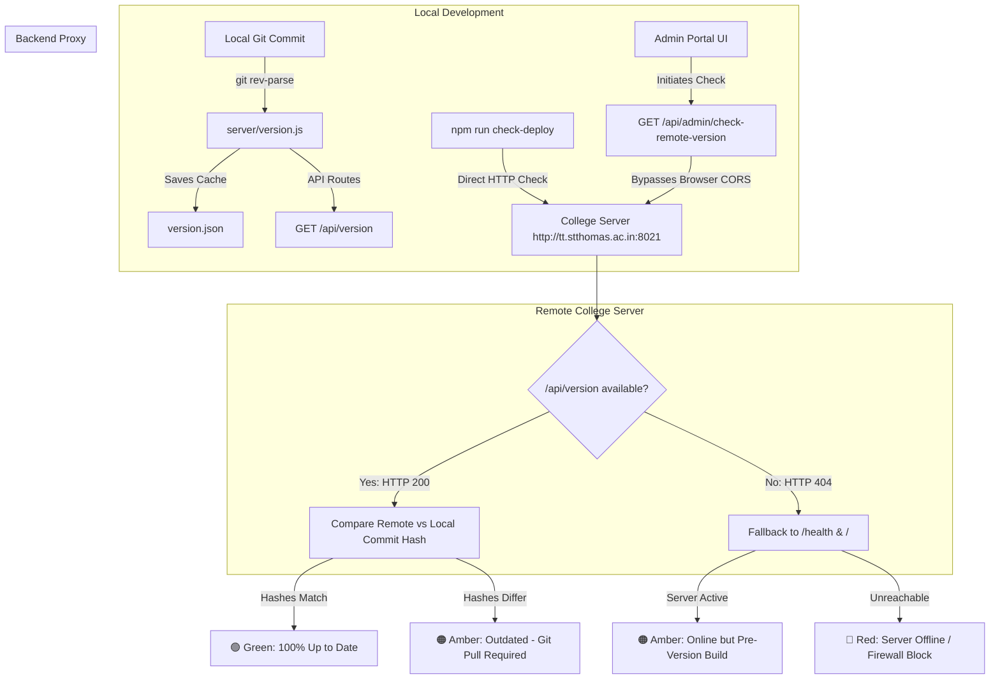

# Version Tracking & Remote Deployment Management

This document provides a comprehensive guide to the **Deployment Version Tracking & Remote Server Verification System** implemented in the College Timetable and Faculty Scheduling platform.

---

## 1. Overview & Purpose

When updating the application code locally and pushing changes to GitHub, the remote production server hosted at the college (e.g., `http://tt.stthomas.ac.in:8021/`) does not update automatically until an administrator executes a manual `git pull` and restarts the Node process.

To prevent confusion about which code version is active, this system provides:
1. **Automated Git Metadata Extraction**: Captures the exact semantic version, short commit hash, commit message, commit date, and active branch at runtime without requiring manual version bumps.
2. **Persistent Fallback Caching**: Writes metadata to [`version.json`](file:///e:/git_repos/college_time_table/version.json) so the version is preserved even in environments where Git is absent or stripped in production.
3. **Public API Endpoints**: Exposes `/api/version` and `/health` for monitoring and status dashboards.
4. **Visual Portal Badges**: Surfaces the active commit hash in both the Department Coordinator login and Central Admin Portal headers.
5. **Remote Server Comparison Tool**: An in-browser tool in the Admin Portal and a CLI utility (`npm run check-deploy`) that queries the live college server, compares commits, and tells you whether the college server is 100% up-to-date or needs a `git pull`.

---

## 2. System Architecture



---

## 3. Core Components

### 3.1 Metadata Extractor (`server/version.js`)
[`server/version.js`](file:///e:/git_repos/college_time_table/server/version.js) uses Node's `child_process.execSync` to dynamically query Git for repository metadata:

| Attribute | Git Command / Source | Example Value |
|---|---|---|
| `version` | [`package.json`](file:///e:/git_repos/college_time_table/package.json) | `1.0.0` |
| `commit` | `git rev-parse --short HEAD` | `ac14b9e` |
| `commitFull` | `git rev-parse HEAD` | `ac14b9e941a820cbbf7dd3909544da88d51e543a` |
| `branch` | `git rev-parse --abbrev-ref HEAD` | `main` |
| `commitDate` | `git log -1 --format=%cd --date=iso` | `2026-10-28 10:33:22 +0530` |
| `commitMessage` | `git log -1 --format=%s` | `program filter added for import and inspect records` |
| `serverUptimeSeconds` | `Math.floor(process.uptime())` | `168968` |

If Git commands fail (e.g., when deployed in a stripped Docker image or zipped deployment), the function automatically falls back to reading [`version.json`](file:///e:/git_repos/college_time_table/version.json).

### 3.2 API Endpoints (`server/server.js`)

1. **`GET /api/version` (or `/version`)**:
   Publicly readable JSON payload containing the local server's deployment status:
   ```json
   {
     "version": "1.0.0",
     "commit": "ac14b9e",
     "commitFull": "ac14b9e941a820cbbf7dd3909544da88d51e543a",
     "branch": "main",
     "commitDate": "2026-10-28 10:33:22 +0530",
     "commitMessage": "program filter added for import and inspect records",
     "serverUptimeSeconds": 93
   }
   ```

2. **`GET /health` (or `/api/health`)**:
   Standard liveness probe enhanced with version and commit metadata.

3. **`GET /api/admin/check-remote-version?url=<SERVER_URL>`**:
   A backend proxy route used by the Admin Portal.
   - **Why a proxy?** If the browser directly makes a cross-origin request (`fetch('http://tt.stthomas.ac.in:8021/api/version')`) to a server running an older build that returns 404 without CORS headers, the browser blocks the response with `TypeError: Failed to fetch`. By delegating this check to the local Node.js backend, all CORS, mixed-content, and intranet network constraints are bypassed.
   - **Smart Fallback**: If `/api/version` returns 404 (because the remote server hasn't pulled this feature yet), the proxy automatically tests `/health` and `/`. If the remote server is online, it reports: *"College server is online, but running an earlier release (pre-version tracking). A git pull is required!"*

---

## 4. User Interface Features

### 4.1 Department Portal Header & Login
- In [`public/index.html`](file:///e:/git_repos/college_time_table/public/index.html) and [`public/js/app.js`](file:///e:/git_repos/college_time_table/public/js/app.js):
  - A subtle version badge appears in the top navigation bar (e.g., `v1.0.0 (ac14b9e)`).
  - Under the Department Coordinator login form, the commit and branch are displayed.
  - Hovering over the badge displays a tooltip with the commit date and message.

### 4.2 Admin Portal System Deployment Card
- In [`public/admin/index.html`](file:///e:/git_repos/college_time_table/public/admin/index.html) and [`public/js/admin.js`](file:///e:/git_repos/college_time_table/public/js/admin.js):
  - Located on the Admin **Status Dashboard**, the **"System Version & Deployment Status"** card provides:
    - Semantic version pill (`v1.0.0`)
    - Deployed commit hash with a one-click copy button
    - Active branch name (`main`)
    - Server process uptime in hours and minutes
    - Latest commit message

### 4.3 Live College Server Comparison Tool
Located inside the Admin Deployment card:
1. Enter your college server address (e.g., `http://tt.stthomas.ac.in:8021`). The system automatically remembers the URL in `localStorage`.
2. Click **Check Server**.
3. The system queries the remote server via the proxy:
   - **Matching Commits**: Displays a green badge: **"College Server is 100% Up-to-Date!"**
   - **Mismatched Commits or Pre-Version Build**: Displays an amber alert detailing the difference and provides a one-click **Copy Command** button:
     ```bash
     git pull origin main && pm2 restart all
     ```
   - **Server Unreachable**: Displays a red alert indicating connection failure and network troubleshooting steps.

---

## 5. Terminal CLI Verification Utility

You can verify any remote deployment directly from the command line without launching a web browser:

```bash
npm run check-deploy <REMOTE_SERVER_URL>
```

### Example 1: Checking the College Server
```bash
npm run check-deploy http://tt.stthomas.ac.in:8021
```

**Output:**
```text
================================================================
   🏫 COLLEGE TIMETABLE SYSTEM - DEPLOYMENT VERSION CHECKER     
================================================================

📌 Local Repository Status:
   - Semantic Version: v1.0.0
   - Branch:           main
   - Commit Hash:      ac14b9e (ac14b9e941a820cbbf7dd3909544da88d51e543a)
   - Commit Date:      2026-10-28 10:33:22 +0530
   - Commit Message:   "program filter added for import and inspect records"

🌐 Querying Remote Server: http://tt.stthomas.ac.in:8021

📡 Remote Server Status:
   - Connection:       ONLINE (200 OK)
   - Server Uptime:    46h 58m active
   - Version Endpoint: 404 Not Found (Server is running code prior to this update)

----------------------------------------------------------------
⚠️  STATUS: COLLEGE SERVER IS ONLINE BUT RUNNING AN OLDER COMMIT!
----------------------------------------------------------------
   The college server at http://tt.stthomas.ac.in:8021 is active, but it does
   NOT have the latest changes yet.
   Local latest commit: ac14b9e ("program filter added for import and inspect records")

👉 ACTION REQUIRED:
   The college server needs a git pull to deploy this update:
   -------------------------------------------------------------
   1. Access the college server terminal
   2. Run:
      git pull origin main
   3. Restart node service:
      pm2 restart all   (or npm start / systemctl restart timetable)
   -------------------------------------------------------------
```

---

## 6. College Server Deployment & Update Guide

When updates have been pushed to GitHub, follow these steps to update the production college server:

1. **SSH / Terminal Access to the College Server**:
   ```bash
   ssh user@tt.stthomas.ac.in
   cd /path/to/college_time_table
   ```

2. **Pull the Latest Code**:
   ```bash
   git pull origin main
   ```

3. **Install Any New Dependencies (if package.json changed)**:
   ```bash
   npm install --production
   ```

4. **Restart the Node Application**:
   - If using **PM2**:
     ```bash
     pm2 restart all
     ```
   - If using **systemd**:
     ```bash
     sudo systemctl restart college-timetable
     ```
   - If running via **NPM / background process**:
     ```bash
     npm start
     ```

5. **Verify Deployment**:
   - Visit `http://tt.stthomas.ac.in:8021/api/version` in your browser.
   - Or run locally:
     ```bash
     npm run check-deploy http://tt.stthomas.ac.in:8021
     ```
   - The status will now read: **🟢 COLLEGE SERVER IS 100% UP TO DATE!**
