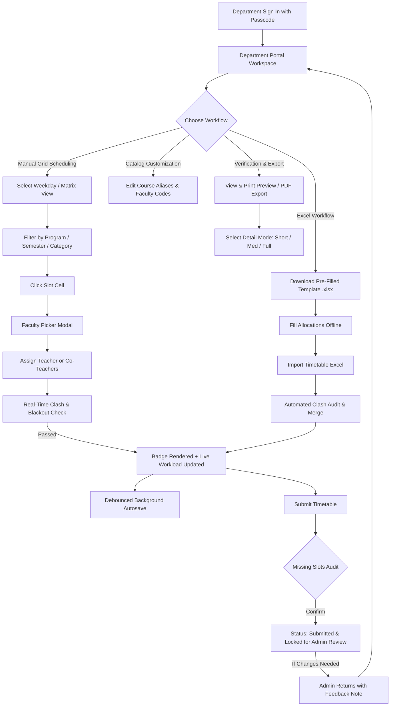

# Manual Period Allocation & Department Portal Features

> **Target Audience:** Department Heads, Academic Coordinators, System Administrators, and Software Engineers.  
> **Scope:** Core manual timetable allocation, interactive matrix scheduling, validation, data editing, and administrative workflows on the **Department Portal** (excluding auto-generation algorithms).

---

## 1. Quick Feature Index (Concise Overview)

The following list summarizes the core capabilities available to a department coordinator upon signing in:

| # | Feature / Capability | Description & Purpose |
| :-: | :--- | :--- |
| **1** | **Department Authentication & Lockouts** | Secure department-level login with passcode, automatic session handling, and edit-locking when a timetable is under review or approved. |
| **2** | **Single-Day vs. Full-Week Grid Views** | Toggle between a focused weekday view (Monday–Friday tabs) to prevent cognitive overload, or a complete 30-period Full Week Timetable Matrix. |
| **3** | **Multidimensional Filters** | Filter courses dynamically by Program (`UG`, `PG`, `INT`), Term Switcher (`All`, `Odd`, `Even`), specific Semester (`1`–`8`), and Subject Category (`Major`, `Minor`, `MDC`, `AEC`, etc.). |
| **4** | **Interactive Slot Allocation Modal** | Click any active grid cell to launch a searchable faculty picker modal with real-time faculty availability and course information. |
| **5** | **Real-Time Double-Booking Clash Protection** | Strict server-side and client-side validation preventing a faculty member from being booked in two courses, classes, or departments at the same period. |
| **6** | **Teacher Availability & Blackout Days** | Respects pre-configured teacher leave or blackout hours; prevents assignment and visually flags blocked slots. |
| **7** | **Multiple Faculty in the Same Slot (Co-Teaching)** | Support for assigning multiple teachers to a single period (labs, team-teaching, tutorial divisions) with a 1-click *"Assign All Co-Teachers"* shortcut. |
| **8** | **Recommended Slot Indicators & Unlocking** | Visual distinction for Recommended Theory (`T`), Practical (`P`), Blocked (`B`), and College-Wide Common Lock (`Admin Lock`) slots, with confirmation prompts for off-pattern assignments. |
| **9** | **Auto-Fill Recommended Slots Toggle** | Header switch that instantly cascades a teacher's assignment across all matching recommended theory or practical slots of that course (Sem 1–4) while avoiding conflicts. |
| **10** | **Instant One-Click Faculty Removal (`×`)** | Color-coded badges for assigned teachers with a red cross icon (`×`) allowing immediate removal from the slot or from within the modal. |
| **11** | **Debounced Background Autosave** | Automatically syncs timetable draft allocations to the persistent database 5 seconds after the coordinator stops making changes, with live timestamp feedback. |
| **12** | **Course Alias & Faculty Visual Code Editing** | In-portal editors to customize course display names, human-friendly short aliases (e.g., `OOPS`, `DS`), and unique 2–3 letter faculty visual initials. |
| **13** | **Class & Batch Allocation Configuration** | Split courses into parallel classes (`C1`, `C2`, up to `C5`) and bind specific student cohorts/batches with visual badge indicators. |
| **14** | **Pre-Filled Department Excel Template Export** | One-click generation of a clean `.xlsx` spreadsheet pre-filled with all registered department courses, categories, and slot columns. |
| **15** | **Excel Timetable Bulk Import** | Upload department timetables directly from Excel; matches teachers by Initials, Staff ID, or Full Name, and validates against clashes before committing. |
| **16** | **Clear Semester Timetable** | Safe, scoped bulk-removal tool to reset allocations for a specific semester or term after modal confirmation. |
| **17** | **Institutional Print & PDF Export (3 Modes)** | Comprehensive print engine with Short (`EJ OOPS`), Medium (`EJ - OOPS`), and Full (`Eber Johns - Object Oriented Programming`) format options. |
| **18** | **Consolidated Teacher-Wise Timetable** | View and print cross-semester master schedules and teaching slips for individual teachers or all faculty in the department. |
| **19** | **Timetable Submission & Revert Lifecycle** | Structured workflow transitioning from `Draft` &rarr; `Submitted` &rarr; `Approved` / `Returned for Changes`, including pre-submission completeness checks and self-service revert capability. |
| **20** | **Live Faculty Workload Tracker** | Real-time counter cards dynamically tracking allocated teaching hours per faculty member as slots are updated. |
| **21** | **Admin Feedback Display** | Prominent alert card displaying administrative notes and revision requirements whenever a timetable is returned for changes. |
| **22** | **Department Passcode Management** | Self-service tool to update the department coordinator passcode securely. |

---

## 2. Detailed Breakdown of Features & Capabilities

---

### 2.1 Workspace Access & Lifecycle Protection

#### Department Sign-In
- Coordinators log in by selecting their department from a dropdown and entering their department-specific passcode.
- Authentication issues an authorized session token (`sessionStorage`), securing all API calls against unauthorized access or cross-department tampering.

#### Timetable Status Badge & Edit Lockout
- **Lifecycle States:**
  - `Draft`: Department has full read/write permission to allocate, import, and edit courses.
  - `Submitted`: Timetable is locked for review by Central Admin. All slot clicks, modal assignments, batch configuration, and alias edits are disabled.
  - `Approved`: Finalized by Admin. Completely immutable.
  - `Returned for Changes`: Edit locks are released. An **Admin Feedback Card** appears at the top of the portal showing specific instructions provided by the Admin.
- **Revert Submission (`btn-revert-submission`):** If a department coordinator submits a timetable by mistake, they can immediately revert it back to `Draft` status using the red **"Revert Submission to Edit"** button (as long as Admin has not marked it `Approved`).

---

### 2.2 Timetable Matrix Views & Filtering Controls

#### Single-Day View (Default)
- Displays one weekday at a time (`MONDAY`, `TUESDAY`, `WEDNESDAY`, `THURSDAY`, `FRIDAY`) via interactive day tabs.
- Designed to minimize visual clutter and allow coordinators to focus on period-by-period scheduling for that specific day.
- Table columns: `Course Code`, `Course Name / Alias`, `Sem`, `Category`, `Batches`, followed by individual periods (`1`, `2`, `3`, `LB`, `4`, `5`, `6`).

#### Full-Week Timetable Matrix Mode (`btn-toggle-grid-mode`)
- Switches the table into an expanded college matrix showing all 5 weekdays side-by-side with 30 period columns (6 active periods + Lunch Break per day).
- Theory (`-T`) and Practical (`-P`) components for the same base course are unified into a single row to keep the layout compact.

#### Multidimensional Filtering Toolbar
1. **Program Filter (`#filter-program`):**
   - Filters between Under Graduate (`UG` / BSc), Post Graduate (`PG` / MSc), and Integrated (`INT`).
   - PG courses are automatically styled with distinct row highlights (`.row-pg`) for easy identification.
2. **Quick Term Switcher (`#term-quick-toggle`):**
   - Segmented buttons for instant switching: **All Sems**, **Odd Sems** (Sem 1, 3, 5), or **Even Sems** (Sem 2, 4, 6).
3. **Semester Filter (`#filter-semester`):**
   - Granular dropdown targeting a specific semester digit (`1` to `8`) or odd/even groupings.
4. **Category Filter (`#filter-category`):**
   - Filters courses by curriculum track: `Major`, `Minor`, `MDC`, `AEC`, `SEC`, `VAC`, etc.
5. **Clear Timetable Button (`#btn-clear-sem-timetable`):**
   - Targeted bulk-clearing action scoped to the active semester filter (e.g. *"Clear Semester 3 Allocations?"*).
   - Prompts with a confirmation modal before removing slot data, leaving other semesters untouched.

---

### 2.3 Interactive Period Slot Clicking & Faculty Picker

#### Slot States & Visual Representations
Every period cell displays contextual visual states:
- **Theory Recommended (`T`):** Highlighted in light gold with a distinct amber border and `"Theory Rec"` label.
- **Practical Recommended (`P`):** Highlighted in soft mint green with an emerald border and `"Practical Rec"` label.
- **Admin Locked / Common Period:** Flagged with a golden padlock icon and detailed banner showing the common activity name (e.g. `MDC`, `AEC`), batch count, offering department, and scheduled teachers.
- **Blocked Slot (`B`):** Soft red background with dashed borders, indicating periods blocked during curriculum planning.
- **Non-Recommended Slot:** Muted gray in Semesters 1–4. Clicking it triggers an intentional unlock confirmation:
  > *"This is a non-recommended timetable slot. Are you sure you want to unlock it for allocation?"*  
  *(In Semester 5 and above, slots are open by default without confirmation).*

#### Faculty Assignment Modal (`#modal-faculty-select`)
- Clicking an active cell opens a dedicated assignment modal.
- **Header Details:** Displays Course Code, Class Number (e.g. `C1`), Course Type (`Theory` or `Practical`), Day, and Period.
- **Live Search Input (`#fac-search-input`):** Coordinators can type to filter teachers instantly by name or initials.
- **Action Buttons per Faculty:**
  - `Assign`: One-click button to assign an available teacher.
  - `Remove`: Displayed for teachers already assigned to this slot.
  - `Unavailable`: Disabled button with a blackout warning if the faculty member marked that day/period off.

---

### 2.4 Real-Time Clash Detection & Validation Engine

The system validates allocations both client-side and server-side:

#### Hard Double-Booking Validation
- When an assignment is attempted, `/api/allocations/validate` performs a complete scan across:
  1. All courses within the department.
  2. Parallel classes/divisions of the same course.
  3. **Other departments across the entire institution.**
- If a faculty member is already scheduled in another course at that exact day and period, assignment is rejected immediately with a descriptive alert:
  > **Hard Booking Clash! Double-booking violation!**  
  > Faculty member *Dr. Mary Smith (MS)* is already allocated to *Database Systems (CSC3CR201 Class C1)* on *MONDAY Period 2* in department *COMPUTER SCIENCE*.

#### Teacher Blackout Slot Protection
- Checks against the department's **Teacher Availability Matrix**. If a coordinator or teacher marked a period as unavailable, the system displays an alert and prevents assignment.

#### Admin Global Lock Notice
- If an administrator marked a period for a college-wide activity (such as Common MDC or Assembly), the slot displays the activity tag and informs the user of the connected cohorts.

---

### 2.5 Multiple Faculty Assignment (Co-Teaching & Labs)

- **Simultaneous Faculty Allocation:** A slot is not restricted to a single teacher. Coordinators can assign multiple faculty members to the same period.
- **Laboratory Sessions:** Multiple teachers can be assigned to oversee lab batches simultaneously.
- **1-Click Co-Teacher Assignment:**
  - When a practical slot is opened, if co-teachers were pre-configured in Subject Teacher Mapping, the modal displays a dedicated green shortcut button:
    > **Assign All Co-Teachers (EJ + SJ)**
  - Clicking this assigns all registered lab teachers to that period in a single click, verifying each teacher against conflict rules.
- **Continuous Modal Workflow:** For practical slots, the modal remains open after an assignment so assistants or co-teachers can be added without having to reopen the dialog.

---

### 2.6 Auto-Fill Recommended Slots Toggle

- Located prominently in the top legend bar (`#toggle-autofill-recommended`).
- **When Switch is ON:**
  - Assigning a teacher to a recommended Theory slot automatically assigns that teacher to **all other recommended Theory slots** for that course across the entire week.
  - Assigning a teacher to a recommended Practical slot automatically assigns them to all matching Practical slots across the week.
- **Constraint-Aware Auto-Fill:**
  - Automatically checks clashes and teacher availability for every slot.
  - If a clash exists on Wednesday Period 4, the auto-fill assigns Monday and Tuesday while safely skipping Wednesday Period 4, preventing corrupt schedules.
- **Scope Restriction:**
  - Operates on Semesters 1–4 where curriculum slots are predefined.
  - Non-recommended slots and Sem 5+ assign only the specific period clicked.
- **Manual Confirm Dialog (`#dialog-autofill`):** If preferred, coordinators can also use the interactive prompt to decide between *"Apply to All Slots"* or *"Apply to Current Only"*.

---

### 2.7 One-Click Faculty Removal (`×` Badges)

- In the timetable matrix, every assigned teacher is rendered as a clean, rounded badge containing their initials code (e.g. `EJ`).
- **Inline Cross Icon (`fa-xmark`):**
  - Hovering over a badge displays a tooltip with the teacher's full name.
  - Clicking the red `×` icon unassigns that teacher immediately without opening any modals.
- **Modal Removal:** Teachers can also be unassigned using the red *"Remove"* button inside the faculty selector modal.
- **Automatic Cascades:** Removing a teacher immediately updates:
  1. The timetable grid cell.
  2. The Live Workload Counter.
  3. The autosave draft queue.

---

### 2.8 Debounced Draft Autosave

- **Silent Persistence:** Manual allocations do not require clicking a "Save" button after every slot change.
- **Debounce Timer (5000ms):** When an allocation changes, the system enters a pending state and automatically syncs all allocations to the backend database 5 seconds after the user stops typing or clicking.
- **Live Status Indicator (`#autosave-status`):**
  - Displays dynamic status messages:
    - *"Draft changes pending..."*
    - *"Saving draft..."*
    - *"Draft autosaved at 10:45:12 AM"*
- **Protection:** Autosave is disabled when the timetable is locked (`Submitted` or `Approved`) to prevent accidental overwrites.

---

### 2.9 Inline Editing for Course Aliases & Faculty Visual Codes

Located below the timetable grid, this section provides coordinators with self-service catalog customization:

#### Course Aliases Subtab (`#subtab-dept-courses`)
- Lists all courses owned by the department.
- **Visual Alias Field:** Coordinators can assign human-friendly abbreviations (e.g., changing `CSC3CR201` display alias to `DS` or `OOPS`).
- **Parallel Classes & Batches:** Displays assigned batches and includes a **Classes (`C1`, `C2`)** configuration button.
- **Actions:** Individual row **Save** buttons or a bulk **"Save All Course Details"** button.

#### Faculty Visual Codes Subtab (`#subtab-dept-faculty`)
- Lists all faculty members registered in the department.
- **Visual Code Field:** Coordinators can customize the 2–3 letter initials code (e.g., `SJ`, `EJ`, `JP`).
- **Duplicate Prevention:** Validates against existing codes across the entire college database to guarantee uniqueness.
- **Actions:** Individual row **Save** buttons or a bulk **"Save All Faculty Codes"** button.

---

### 2.10 Class & Batch Allocation Configuration Modal

- **Purpose:** Manages courses that divide students into parallel classes or lab divisions.
- **Class Count Dropdown:** Select from 1 Class (no split) up to 5 Classes (`C1`, `C2`, `C3`, `C4`, `C5`).
- **Cohort Mapping:** Assign specific student batches (e.g., `U1CS2024`, `U1PY2024`) to each class division.
- **Visual Differentiation:** The matrix renders individual rows for each class with a colored class badge (e.g., `CSC3CR201 C1`, `CSC3CR201 C2`).

---

### 2.11 Excel Template Generation & Timetable Import

#### Format Guide Modal (`#modal-dept-excel-format`)
- Outlines expected column structures:
  - **Required:** `Course Code`
  - **Optional:** `Course Name`, `Semester`, `Category`
  - **Slot Columns:** `MON-1`, `MON-2` ... `FRI-6`
  - **Cell Value Rules:** Initials (e.g. `EJ`), Staff IDs (`STF101`), or Full Names. Multiple teachers separated by `/` or `,` (e.g. `EJ / SJ`).

#### Download Department Template (`btn-download-dept-template`)
- Dynamically generates and downloads an `.xlsx` file customized for the department.
- Pre-populated with all department course codes, names, semesters, categories, and any existing allocations already saved in the system.

#### Import Timetable (`btn-dept-import-excel`)
- Uploads an Excel file directly into the department portal.
- **Intelligent Teacher Resolution:** Matches cell values against Faculty Initials, Staff IDs, Full Names, and cleaned titles (`Dr.`, `Prof.`).
- **Clash Verification:** Validates the entire imported schedule against double-booking rules across all departments before committing.
- **Detailed Import Reports:** Shows success counts and specific warnings for skipped rows or unrecognized faculty names.

---

### 2.12 View & Print Preview (Printable Timetable Sheet)

Accessible via the **"View & Print Table"** button (`#btn-preview-timetable`):

#### 3 Display Detail Modes
Coordinators can switch the visual detail level using the format dropdown:
1. **Short Mode:** `EJ OOPS` (Faculty code + course alias).
2. **Medium Mode (Default):** `EJ - OOPS` (Formatted hyphen separator).
3. **Full Mode:** `Eber Johns - Object Oriented Programming (TH)` (Full teacher name, full course title, and theory/practical marker).

#### Printable Department Sheet
- Renders an autonomous college header:
  - Department Name
  - College Autonomous Title & Location
  - Term (`ODD SEMESTER` / `EVEN SEMESTER`) and Academic Year
- Organizes schedules by Day & Program/Semester category hierarchy (`MSc`, `BSc Major`, `Minor`, etc.).
- Includes Theory vs. Practical color legends.
- **Print Timetable PDF:** Browser print styling (`@media print`) optimized for A4/A3 landscape PDF export.
- **Export CSV Grid:** One-click download of the active rendered grid as a `.csv` file.

---

### 2.13 Consolidated Teacher-Wise Timetable

- Accessible from the View Preview modal or Advanced Features.
- **Aggregated Faculty Schedules:** Select any faculty member (or view all teachers sequentially) to see their complete weekly schedule across **all semesters, programs, and courses**.
- **Co-Teaching Visibility:** Clearly marks periods where the teacher is co-teaching a lab session with another colleague.
- **Individual PDF Slips:** Export individual schedule slips for distribution to faculty members.

---

### 2.14 Real-Time Faculty Workload Tracker

- Located directly below the timetable matrix (`#dept-live-workload`).
- **Dynamic Workload Badges:** Renders interactive pill badges for each department faculty member (e.g., `[ EJ | 14 hrs ]`, `[ SJ | 12 hrs ]`).
- **Instant Synchronization:** Automatically increments or decrements hours in real time as slots are assigned, cleared, or imported.
- Helps coordinators ensure balanced distribution of teaching hours across staff members without manual counting.

---

### 2.15 Timetable Submission & Validation Workflow

- Activated via the **"Submit Timetable"** button (`#btn-submit-timetable`).
- **Pre-Submission Completeness Audit:**
  - Scans all recommended theory and practical slots for every course in the department.
  - If any recommended slots lack an assigned teacher, an alert modal lists the missing slots:
    > **Missing Recommended Slots**  
    > *ENG5MA101 alias 'LIT' requires allocation on MONDAY Period 1*  
    > *CSC3CR201 (Class C1) alias 'DS' requires allocation on TUESDAY Period 2*  
    > *Do you want to proceed with submission?*
- **Final Submission:**
  - Transitions the status to `Submitted`.
  - Notifies Central Admin on their master dashboard.
  - Activates read-only edit locks on the department portal.

---

### 2.16 Department Passcode Management

- Available within the **Advanced Features** workspace under **Change Password**.
- Allows department coordinators to update their access passcode.
- Requires current password verification, enforces minimum length requirements (min 4 characters), and confirms matching entries.
- Stored using secure encryption (`encryptDeptPasscode`), invalidating stale sessions immediately.

---

## 3. Summary of User Workflow

