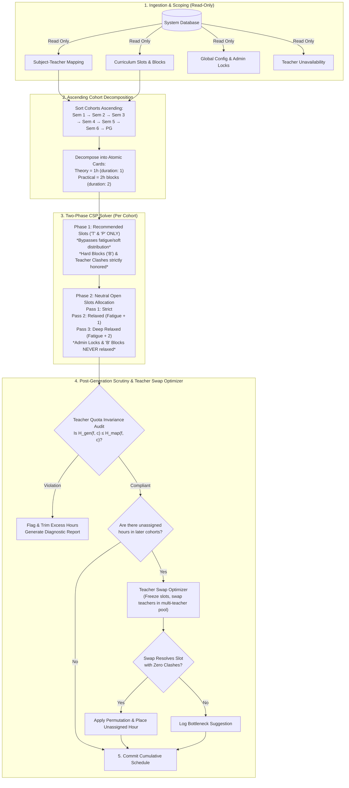
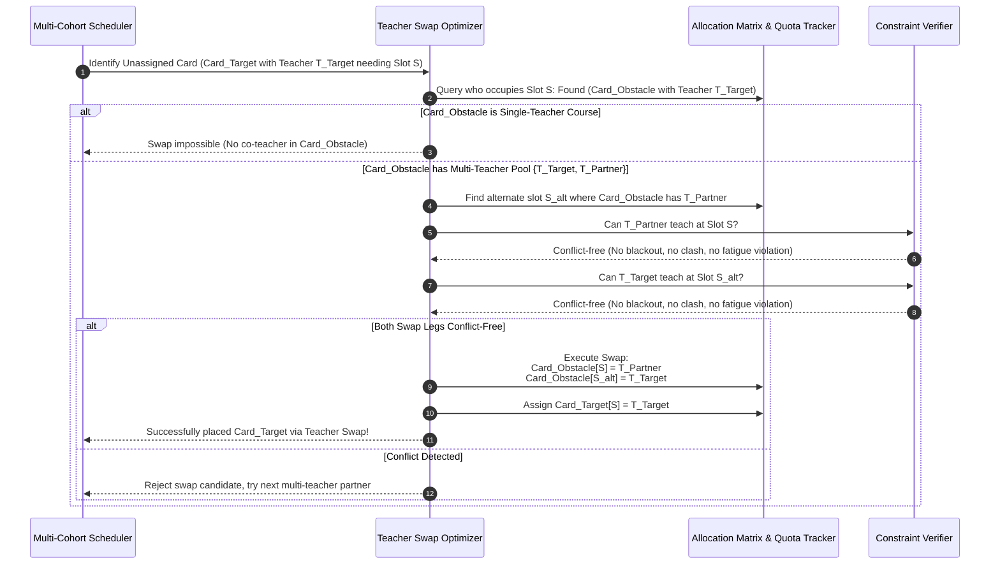
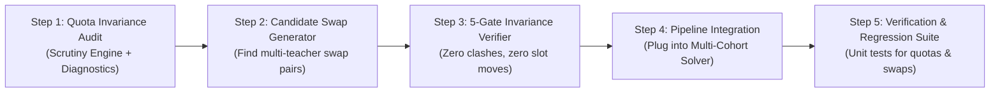

# Timetable Auto-Generation: Teacher Quota Invariance Audit & Post-Generation Teacher Swap Optimizer

## 1. Executive Summary

This specification defines the architectural design, workflow integration, and algorithmic implementation for two interrelated features in the **College Timetable Allocation System** (`server/scheduler.js`):

1. **Teacher Quota Scrutiny & Invariance Engine**:
   - Formally audits that for every faculty member $f$ and every course $c$, the auto-generated allocated hours $H_{\text{gen}}(f, c)$ **never exceed** the mapped hours $H_{\text{map}}(f, c)$ defined in Subject-Teacher Mapping (`db.subjectTeacherMapping`).
   - If any discrepancy is detected, the engine pinpoints the exact course and teacher where the excess occurred without ever modifying `db.subjectTeacherMapping` (which remains strictly read-only).
2. **Post-Generation Teacher Swap Optimizer**:
   - Resolves unassigned/bottleneck course hours in later semesters (e.g., Semester 5) caused by teacher schedule conflicts with earlier semesters (e.g., Semester 1).
   - Achieves this by **swapping teachers within multi-teacher courses** across previously scheduled slots.
   - **Absolute Core Invariant**: **Assigned slots (Day and Period) — especially curriculum-recommended slots ('T' and 'P') — are 100% frozen and immutable**. Only the *teacher assignment* within the course's authorized teacher pool is permuted.

---

## 2. Complete Auto-Generation Workflow & Constraint Hierarchy

### 2.1 Workflow Pipeline Architecture



### 2.2 Parameter & Constraint Classification Matrix

The engine evaluates constraints in a strict hierarchical order. Lower-tier constraints can never violate higher-tier constraints:

| Tier | Constraint Name | Enforcement Scope | Relaxation Permitted? | Description |
| :--- | :--- | :--- | :--- | :--- |
| **Tier 0** | **Curriculum Blocked (`'B'`)** | Global / Departmental | **NEVER** | Slots marked `'B'` are hard physical blackout zones (parallel minor/MDC slots). |
| **Tier 0** | **Admin Global Locks** | Institution / Cohort | **NEVER** | Period blocks configured by Administrators (e.g. Period 6 across all weekdays). |
| **Tier 0** | **Teacher Unavailability** | Faculty Specific | **NEVER** | Unwanted/leave periods configured in Teacher Availability tab. |
| **Tier 0** | **Single Teacher Physical Presence** | Faculty Specific | **NEVER** | No teacher can teach in two classrooms at the exact same day and period. |
| **Tier 0** | **Teacher Quota Invariance** | Course-Faculty Pair | **NEVER** | Allocated hours $H_{\text{gen}}(f, c)$ cannot exceed mapped quota $H_{\text{map}}(f, c)$. |
| **Tier 1** | **Curriculum Recommendations (`'T'`, `'P'`)** | Course Specific | **NEVER** | Priority 1 allocation. Phase 1 guarantees these are locked first. |
| **Tier 1** | **Laboratory Capacity (Single Lab)** | Departmental | Strict Pass only | Maximum 1 practical lab running per department per period. |
| **Tier 2** | **Student Cohort Clash** | Semester / Program | Strict Pass only | Same semester students cannot attend parallel classes unless disjoint divisions (`C1`/`C2`). |
| **Tier 3** | **Consecutive Fatigue Limit** | Faculty Specific | Relaxed: $+1$, Deep: $+2$ | Max consecutive hours (default 2 in strict, 3 in relaxed, 4 in deep relaxed). |
| **Tier 4** | **Weekday Spread & Balance** | Pedagogical Heuristic | Disabled in Deep Relax | Spread hours across weekdays (1 hr/day before 2 hrs/day). |
| **Tier 4** | **Shift & Anti-Mono-Period Balance**| Pedagogical Heuristic | Disabled in Deep Relax | Distribute evenly between morning (P1–P3) and afternoon (P4–P6). |

---

## 3. Part 1: Teacher Quota Invariance Audit Engine

### 3.1 Mathematical Invariance Rule

For any department $D$, faculty member $f \in \text{Faculty}$, and course $c \in \text{Courses}$:
$$H_{\text{gen}}(f, c) \le H_{\text{map}}(f, c)$$

Where:
- $H_{\text{map}}(f, c)$: Hours mapped in `db.subjectTeacherMapping[D][c]` (or explicit `theoryTeacherHours[f]` / `practicalHours`).
- $H_{\text{gen}}(f, c) = \sum_{d \in \text{Days}} \sum_{p \in \text{Periods}} \mathbb{I}(f \in \text{Allocations}[c][d][p])$: Total hours assigned to teacher $f$ for course $c$ across the week.

### 3.2 Audit Workflow & Read-Only Safety Guardrail

1. **Read-Only Invariance**:
   - `db.subjectTeacherMapping` is treated as an immutable contract.
   - The engine **never writes, updates, or scales** values in `db.subjectTeacherMapping`.
2. **Post-Solver Audit Step**:
   - Immediately after Phase 2 completes, the audit function scans the resulting schedule matrix:
     ```javascript
     function auditTeacherHourQuotas(allocations, targetCourses, resolvedBindings, deptUpper) {
       const quotaDiscrepancies = [];
       targetCourses.forEach(course => {
         const binding = resolvedBindings[course.code] || {};
         const expectedHours = getExpectedTeacherHours(binding, course);
         const actualHours = countActualPlacedHours(allocations[course.code]);

         Object.keys(expectedHours).forEach(facCode => {
           const mapped = expectedHours[facCode] || 0;
           const placed = actualHours[facCode] || 0;
           if (placed > mapped) {
             quotaDiscrepancies.push({
               department: deptUpper,
               courseCode: course.code,
               courseName: course.name,
               facultyCode: facCode,
               mappedHours: mapped,
               generatedHours: placed,
               excessHours: placed - mapped
             });
           }
         });
       });
       return quotaDiscrepancies;
     }
     ```
3. **Corrective Enforcement**:
   - If $H_{\text{gen}}(f, c) > H_{\text{map}}(f, c)$, the engine automatically revokes the excess allocations from neutral slots (never touching recommended slots) and triggers the Teacher Swap Optimizer to find alternative eligible faculty.

---

## 4. Part 2: Post-Generation Teacher Swap Optimizer

### 4.1 Problem Definition & Practical Scenario

Consider the concrete situation described by the user:

```
[Semester 1]
Course: MAT1CJ101 (4 Hours/week, Multi-Teacher Course)
Teachers: Prof. A (2 hrs) and Prof. B (2 hrs)
Allocated Slots:
  - Monday Period 2: Prof. A  <-- Curriculum Recommended Slot!
  - Wednesday Period 2: Prof. B
  - Thursday Period 1: Prof. A
  - Friday Period 3: Prof. B

[Semester 5]
Course: MAT5CJ301 (5 Hours/week, Single Teacher Course)
Teacher: Prof. A (5 hrs)
Constraint Bottleneck:
  - Monday Period 2 is the ONLY feasible open slot for Semester 5 students.
  - But Prof. A is already booked in Semester 1 on Monday Period 2!
  - Direct placement creates a Double-Booking Clash for Prof. A.
  - Result: 1 hour of MAT5CJ301 remains unassigned.
```

### 4.2 The Solution: Intra-Course Teacher Swap

Rather than moving the slot or moving the course:
1. **Freeze the slots**: Monday Period 2 and Wednesday Period 2 **stay exactly where they are**.
2. **Swap teachers within MAT1CJ101**:
   - Before: Monday P2 = Prof. A, Wednesday P2 = Prof. B
   - After:  Monday P2 = **Prof. B**, Wednesday P2 = **Prof. A**
3. **Verify validity**:
   - Does Prof. B have a blackout or clash on Monday Period 2? $\rightarrow$ Verified: No.
   - Does Prof. A have a blackout or clash on Wednesday Period 2? $\rightarrow$ Verified: No.
   - Total hours for Prof. A on MAT1CJ101: Still 2 hours.
   - Total hours for Prof. B on MAT1CJ101: Still 2 hours.
   - Did any recommended slot move? **No. Monday P2 and Wednesday P2 are preserved.**
4. **Allocate Semester 5**:
   - Monday Period 2 is now free for Prof. A!
   - Assign MAT5CJ301 on Monday Period 2 with Prof. A.
   - Outcome: **100% allocation achieved without any clashes or slot movements.**

---

### 4.3 Detailed Swap Optimizer Algorithm



### 4.4 Invariant Rules for Swapping

Every proposed swap must satisfy all five **Invariance Gates**:

1. **Gate 1: Slot Immutability Gate**:
   $$\text{Slot}(c, s) = (d, p) \quad \text{remains strictly unchanged}$$
   No day or period of any course is ever shifted.
2. **Gate 2: Pool Membership Gate**:
   Both teachers in the swap must belong to the authorized teacher pool for that course and category:
   $$T_{\text{target}}, T_{\text{partner}} \in \text{CoursePool}(c, \text{type})$$
3. **Gate 3: Individual Quota Invariance Gate**:
   $$\Delta H(T_{\text{target}}, c) = 0, \quad \Delta H(T_{\text{partner}}, c) = 0$$
   The weekly hour count of each teacher on the swapped course remains identical.
4. **Gate 4: Zero Clash & Blackout Gate**:
   - $T_{\text{partner}}$ must have **0 clashes** across all departments at slot $S$.
   - $T_{\text{target}}$ must have **0 clashes** across all departments at slot $S_{\text{alt}}$.
   - Neither teacher can have an unwanted/blackout flag on their new slot.
5. **Gate 5: Fatigue & Consecutive Hours Gate**:
   Neither teacher's new daily sequence can exceed the allowed consecutive hours on that day.

---

## 5. Implementation Architecture & Data Flow

### 5.1 New Module Structure

The implementation will be modularized cleanly inside [`server/scheduler.js`](file:///c:/Users/Nitto/Desktop/repo/faculty-scheduling/server/scheduler.js):

```
server/
  ├── scheduler.js                     <-- Core Solver & Entry Point
  │     ├── generateDepartmentSchedule()
  │     ├── generateMultiCohortSchedule()
  │     ├── [NEW] auditTeacherHourQuotas()
  │     ├── [NEW] runTeacherSwapOptimizer()
  │     └── [NEW] tryTeacherSwapForCard()
```

### 5.2 Algorithm Pseudocode: `runTeacherSwapOptimizer`

```javascript
/**
 * Post-Generation Optimizer: Resolves unassigned cards by swapping teachers
 * in multi-teacher courses across existing conflict-free slots.
 * 
 * Rules:
 * 1. Slots are 100% frozen.
 * 2. Only teacher assignments within multi-teacher courses are permuted.
 * 3. Quotas and blackout rules are strictly invariant.
 */
function runTeacherSwapOptimizer({
  allocations,
  unassignedCards,
  targetCourses,
  resolvedFacultyBindings,
  db,
  deptUpper
}) {
  const resolvedCards = [];

  for (const card of unassignedCards) {
    const candidatePlacements = getPrioritizedCandidatePlacements(allocations, card, true, true, 2);
    let cardResolved = false;

    for (const { day, slotGroup } of candidatePlacements) {
      // Find which teacher(s) in card's pool could teach this slot if available
      const pool = card.assignedFaculty.length > 0 ? card.assignedFaculty : card.facultyPool;
      
      for (const targetTeacher of pool) {
        // If targetTeacher is already free at this slot, no swap needed
        if (isTeacherFreeAtSlot(allocations, day, slotGroup, targetTeacher, db)) {
          assignCardToSlot(allocations, card, day, slotGroup, [targetTeacher]);
          cardResolved = true;
          break;
        }

        // Target teacher is busy. Identify which course C_obs occupies targetTeacher at (day, slotGroup)
        const obstacleCourseCode = findCourseOccupyingTeacher(allocations, day, slotGroup, targetTeacher);
        if (!obstacleCourseCode) continue;

        // Check if C_obs is a multi-teacher course with swap candidate partners
        const obstacleBinding = resolvedFacultyBindings[obstacleCourseCode];
        if (!obstacleBinding || !obstacleBinding.teachers || obstacleBinding.teachers.length <= 1) {
          continue; // Single teacher course cannot swap
        }

        const candidatePartners = obstacleBinding.teachers.filter(t => t !== targetTeacher);
        
        // Find alternative slots of C_obs where a partner teacher is currently teaching
        const obstacleSlots = getCourseWeeklySlots(allocations, obstacleCourseCode);
        
        for (const partnerTeacher of candidatePartners) {
          const partnerSlots = obstacleSlots.filter(s => 
            allocations[obstacleCourseCode][s.day][s.period].includes(partnerTeacher)
          );

          for (const altSlot of partnerSlots) {
            // Test 2-way swap feasibility:
            // 1. partnerTeacher moves to (day, slotGroup)
            // 2. targetTeacher moves to (altSlot.day, altSlot.period)
            const canPartnerTakeObstacleSlot = canTeacherTakeSlot(
              allocations, obstacleCourseCode, day, slotGroup, partnerTeacher, db
            );
            const canTargetTakeAltSlot = canTeacherTakeSlot(
              allocations, obstacleCourseCode, altSlot.day, [altSlot.period], targetTeacher, db
            );

            if (canPartnerTakeObstacleSlot && canTargetTakeAltSlot) {
              // Execute the swap!
              executeTeacherSwap(
                allocations,
                obstacleCourseCode,
                { day, periods: slotGroup, newTeacher: partnerTeacher, oldTeacher: targetTeacher },
                { day: altSlot.day, periods: [altSlot.period], newTeacher: targetTeacher, oldTeacher: partnerTeacher }
              );

              // Target teacher is now free! Allocate target card
              assignCardToSlot(allocations, card, day, slotGroup, [targetTeacher]);
              cardResolved = true;
              resolvedCards.push(card);
              break;
            }
          }
          if (cardResolved) break;
        }
        if (cardResolved) break;
      }
      if (cardResolved) break;
    }
  }

  return {
    resolvedCardsCount: resolvedCards.length,
    remainingUnassigned: unassignedCards.filter(c => !resolvedCards.includes(c))
  };
}
```

---

## 6. Integration & Diagnostic Reporting Plan

### 6.1 Diagnostic Reporting

When the engine runs auto-generation, it will return a dedicated **`quotaAudit`** and **`swapOptimizations`** section in the diagnostic output:

```json
{
  "success": true,
  "auditReport": {
    "totalCourses": 18,
    "totalAllocatedSlots": 64,
    "quotaInvarianceVerified": true,
    "excessHoursDetected": 0,
    "swapsApplied": [
      {
        "unassignedCourse": "MAT5CJ301",
        "beneficiaryFaculty": "JA",
        "swappedCourse": "MAT1CJ101",
        "partnerFaculty": "SAS",
        "slot": { "day": "MONDAY", "period": "2" },
        "altSlot": { "day": "WEDNESDAY", "period": "2" },
        "reason": "Permuted teacher on multi-teacher course MAT1CJ101 to free Monday Period 2 for Semester 5."
      }
    ]
  }
}
```

---

## 7. Step-by-Step Implementation Roadmap



### Detailed Steps:
1. **Step 1: Teacher Quota Scrutiny Engine**:
   - Implement `auditTeacherHourQuotas()` to verify $H_{\text{gen}}(f, c) \le H_{\text{map}}(f, c)$.
   - Add course-level attribution so the exact course and teacher are reported if any discrepancy is ever found.
2. **Step 2: Swap Candidate Identifier**:
   - For any unassigned card in later cohorts, identify if the bottleneck teacher is teaching an earlier multi-teacher course at the needed slot.
3. **Step 3: 5-Gate Invariance Verification**:
   - Verify that swapping teachers between slot $S$ and $S_{\text{alt}}$ creates **zero clashes**, preserves **all quotas**, and leaves **all slots frozen**.
4. **Step 4: Integration in Multi-Cohort Solver**:
   - Connect `runTeacherSwapOptimizer()` after Pass 2 in [`generateMultiCohortSchedule`](file:///c:/Users/Nitto/Desktop/repo/faculty-scheduling/server/scheduler.js#L280).
5. **Step 5: Test Suite**:
   - Create `tests/test_teacher_quota_and_swap_optimizer.js` testing:
     - Exact scenario: Sem 1 vs Sem 5 teacher conflict resolved via teacher swap.
     - Recommended slots remain 100% frozen.
     - Teacher hour quotas remain strictly identical.

